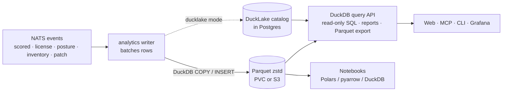

# Analytics: Arrow, DuckDB, Parquet, DuckLake

Postgres answers "what is true now". The lakehouse answers "how did we get
here": every finding change, every license verdict, every posture result,
kept as compressed columnar Parquet.



## Modes

| | `parquet` (default) | `ducklake` |
|---|---|---|
| Storage | Hive-partitioned Parquet (`table/day=YYYY-MM-DD/*.parquet`) on a PVC or S3 | Parquet on S3 + catalog tables in Postgres |
| Transactions, schema evolution, time travel | – | ✓ |
| Small-file compaction | Daily snapshot only | `ducklake_merge_adjacent_files` nightly |
| Extra infra | none | S3-compatible storage (Ceph RGW in your cluster works) |
| Best for | homelab, edge, laptops | production, long history, many readers |

DuckLake on Ceph RGW:

```yaml
analytics:
  mode: ducklake
  s3:
    dataPath: s3://gjallar-lake/
    endpoint: rook-ceph-rgw-store.rook-ceph.svc:80
    existingSecret: gjallar-lake-s3      # keys: access-key, secret-key
```

The catalog uses the same Postgres as the API (secret key `LAKE_CATALOG`).
The analytics image has the `ducklake`, `postgres` and `httpfs` DuckDB
extensions **built in**, so nothing is downloaded at runtime (air-gap friendly).

## Where Arrow fits

DuckDB runs on Arrow-style columnar vectors and reads and writes Arrow
natively. Gjallar keeps everything columnar end to end: rows become Parquet,
and Parquet loads into Arrow with no conversion in pyarrow, Polars or pandas.
For notebooks, `POST /api/v1/analytics/export` returns a Parquet file of any
read-only query:

```python
import polars as pl, requests
r = requests.post("https://gjallar.example.com/api/v1/analytics/export",
                  headers={"Authorization": f"Bearer {token}"},
                  json={"sql": "SELECT * FROM finding_daily"})
df = pl.read_parquet(r.content)            # Arrow-backed DataFrame
```

Or attach the lakehouse directly with read-only credentials:

```python
import duckdb
con = duckdb.connect()
con.sql("INSTALL ducklake; LOAD ducklake;")
con.sql("ATTACH 'ducklake:postgres:dbname=gjallar host=pg user=reader' AS lake (DATA_PATH 's3://gjallar-lake/', READ_ONLY)")
tbl = con.sql("FROM lake.finding_daily").arrow()   # pyarrow.Table
```

## Tables

| Table | One row per | Key columns |
|---|---|---|
| `finding_events` | finding change (match, rescore, fix, accept) | `ts, id, digest, repository, namespaces[], vuln_id, package, severity, cvss, epss, kev, risk, band, state, first_seen, fixed_at` |
| `finding_daily` | finding per day (snapshot) | `day, id, …, risk, band, state, first_seen, fixed_at` |
| `package_licenses` | package × license × evaluation | `digest, package, version, license, verdict` |
| `posture_events` | violation per evaluation | `workload_id, namespace, check_id, severity, container, message` |
| `workload_images` | container per inventory pass | `cluster, namespace, kind, name, container, repository, tag, digest, exposed` |
| `patch_events` | Copa run | `digest, patched_ref, fixed, error` |
| `sbom_packages` | package × image (every stored SBOM) | `digest, repository, package, version, pkg_type, purl`: "where is log4j?" |
| `risk_scores` | finding score change, with its inputs | `id, digest, vuln_id, package, risk, band, cvss, epss, kev, runtime (loaded / not_loaded / unknown), exposed, fix_available, reasons[]` |
| `audit_events` | state-changing API call | `user, client, method, path, status` (who accepted, patched, scanned) |
| `runtime_loaded` | package first seen loading in an image | `digest, package` (Inspektor Gadget, see architecture.md) |

Use `DESCRIBE finding_events` in the UI for exact types.

## Arrow Flight SQL (port 8815)

`gjallar-analytics` also serves the lakehouse over **Arrow Flight SQL**, so
notebooks and BI tools get typed Arrow record batches instead of JSON. Each
query runs once in DuckDB, is written to a temporary Parquet file (exact
types), streamed as Arrow, then deleted. Same read-only SQL rules as the REST
endpoint. With Keycloak configured, every call needs
`authorization: Bearer <token>` with a fleet-wide role
(`tenancy.globalRoles`, default `gjallar-admin`).

```python
# pip install adbc-driver-flightsql pyarrow
import adbc_driver_flightsql.dbapi as flight
con = flight.connect("grpc://gjallar-analytics.gjallar.svc:8815",
                     db_kwargs={"adbc.flight.sql.authorization_header": f"Bearer {token}"})
cur = con.cursor()
cur.execute("SELECT runtime, band, count(*) n FROM risk_scores GROUP BY ALL")
tbl = cur.fetch_arrow_table()            # pyarrow.Table, no conversion
```

DBeaver/JDBC: driver `org.apache.arrow.driver.jdbc.ArrowFlightJdbcDriver`,
URL `jdbc:arrow-flight-sql://gjallar-analytics:8815?useEncryption=false&token=<token>`.
Put TLS in front (Ingress with gRPC, or a service mesh) outside the cluster.
Turn it off with `GJALLAR_FLIGHT_ADDR=off`.

## Curated reports

`GET /api/v1/analytics/reports/<name>`, `gjallar report <name>`, or the MCP
`analytics_report` tool:

| Report | Question it answers |
|---|---|
| `risk_trend` | Open findings per band per day |
| `time_to_fix` | Median hours from first seen to fixed, per namespace |
| `top_packages` | Which packages carry the most risk across images |
| `kev_exposure` | Every known-exploited CVE and the images that carry it |
| `license_denials` | Denied licenses by image count |
| `posture_by_check` | Workloads failing each posture check (latest day) |
| `package_inventory` | Every package, how many images carry it, which versions |
| `runtime_effect` | Findings per runtime state (loaded / not loaded / unknown) and band, with average risk |
| `runtime_loaded_packages` | Packages seen loading at runtime, by image count |

## Example queries

```sql
-- Which teams are getting worse? (urgent findings this week vs last)
SELECT unnest(namespaces) AS ns,
       count(*) FILTER (WHERE day >= current_date - 7)                         AS this_week,
       count(*) FILTER (WHERE day <  current_date - 7 AND day >= current_date - 14) AS last_week
FROM finding_daily WHERE band = 'urgent' AND state = 'open'
GROUP BY ALL ORDER BY this_week - last_week DESC;

-- Where does log4j still run?
SELECT DISTINCT repository, version, namespaces
FROM finding_events WHERE package ILIKE '%log4j%' AND state = 'open';

-- How much did the last DB update change?
SELECT db_version, count(DISTINCT id) FROM finding_events GROUP BY ALL ORDER BY 1 DESC LIMIT 5;
```

## Safety of the SQL endpoint

Queries must be one statement starting with `SELECT`, `WITH`, `FROM`,
`DESCRIBE`, `SUMMARIZE`, `SHOW`, `PIVOT` or `VALUES`. Write and configuration
keywords, `ATTACH`, `COPY`, `INSTALL`, `LOAD`, `SET` and file functions
(`read_*`, `glob`, `getenv`) are rejected, and so are comments. Results are
capped (default 10,000 rows) and time out after 2 minutes. In DuckLake mode
the catalog is attached `READ_ONLY`.

## Why one writer

Many workers writing Parquet directly would produce thousands of tiny files
and catalog conflicts. Instead every event goes through one
`analytics-writer`. It batches rows (`GJALLAR_LAKE_FLUSH`, default 30 s), so
there is one file per table per flush. If a write fails, the batch is
re-queued in memory, and NATS keeps the events for 7 days.
