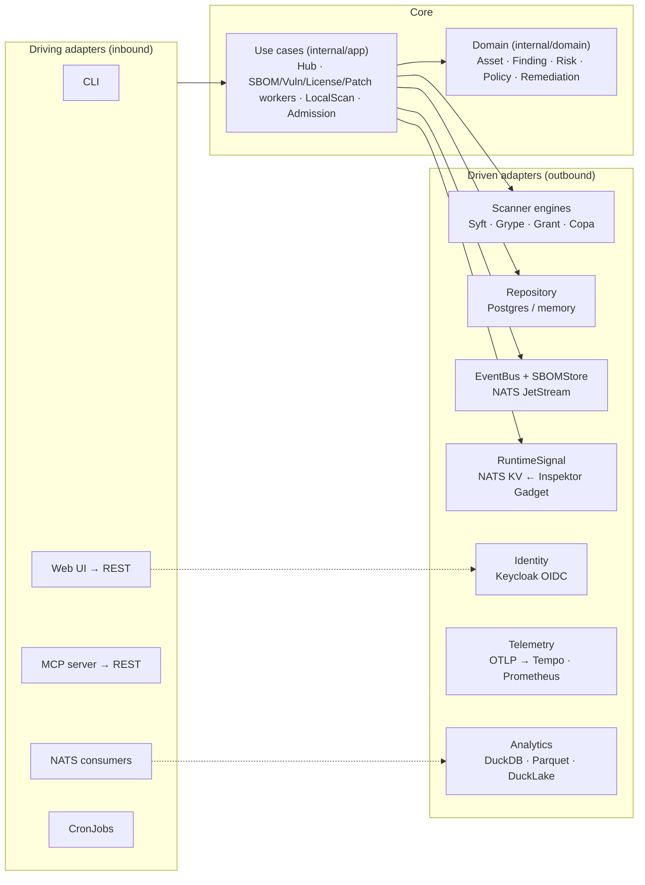
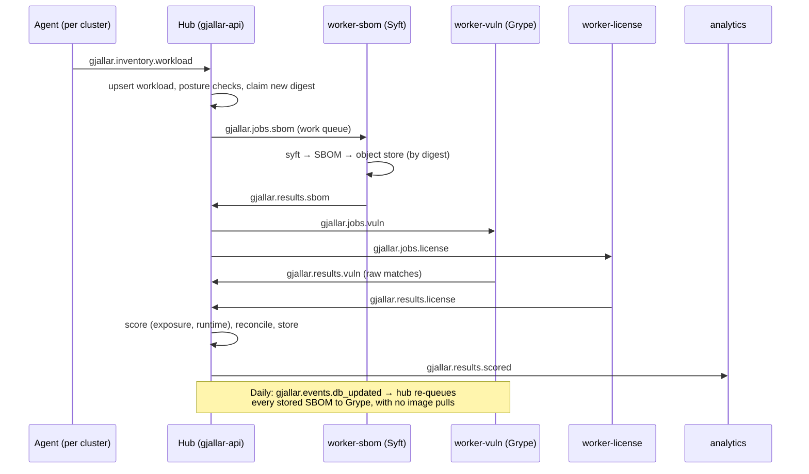
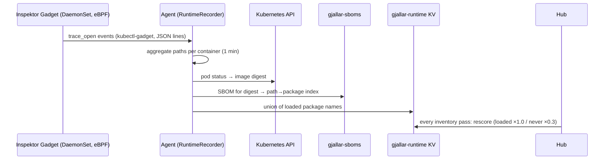

# Architecture

Gjallar uses hexagonal architecture (ports and adapters) with domain-driven
bounded contexts. The domain in the middle depends on nothing. Scanners,
databases, queues and user interfaces are adapters behind interfaces (ports)
that the core defines.

## The hexagon



The ports live in `internal/app/ports.go`:

| Port | Adapter(s) | Swap it for |
|---|---|---|
| `SBOMGenerator` | `scanner.Syft` | Trivy SBOM, Tern, a registry's own SBOM API |
| `VulnMatcher` | `scanner.Grype` (default), `scanner.Trivy`, `scanner.OSV` (offline second source, merged) | any matcher that reads Syft JSON or CycloneDX |
| `LicenseChecker` | `scanner.BuiltinLicenses`, `scanner.Grant` | ScanCode, FOSSA |
| `Patcher` | `scanner.Copa` | Rebuild bot, Renovate PRs |
| `RuntimeSignal` | `natsbus.RuntimeKV`, `app.NoRuntime` | Tetragon, Falco, Kubescape node-agent |
| `EventBus`, `SBOMStore` | `natsbus.Bus`, `memory.Bus/Store` | Kafka, S3 |
| `Repository` | `postgres.Repo`, `memory.Repo` | any SQL database |
| `Attestor` | `scanner.Cosign`: signed SBOM (`https://syft.dev/bom`) and VEX (`openvex`) attestations | Notation, in-toto attestors |
| `SBOMConverter` | `scanner.Syft` (`syft convert`) | CycloneDX/SPDX tools |
| `RegistryCatalog` | `harbor.Catalog`, `registry.Catalog` (any OCI Distribution registry) | GHCR, ECR, Quay, Artifactory APIs |
| `AlertSender`, `AlertLedger` | `notify.Webhook` (Slack, Teams, JSON), `natsbus.Ledger` | PagerDuty, email |
| `ContainerDigests`, `RuntimeStore` | `k8s.Client`, `natsbus.RuntimeKV` | (runtime producer, see below) |

Driving adapters added in 2026-11: **Flight SQL** (`adapters/flightsql`, gRPC on
the analytics pod) and the **regolibrary** policy engine in the agent
(`adapters/rego`, OPA CLI over Kubescape's open controls).

Engines run as **subprocesses** (their official CLIs), not linked libraries.
That keeps the Go binaries static and CGO-free (9–17 MB each). It also means
any engine can be upgraded by changing an image tag, and an engine crash
cannot take down Gjallar.

## Bounded contexts

| Context | Owns | Code |
|---|---|---|
| Inventory | `Workload`, `Container`, `Image(digest)`: what runs where, exposure, security context | `domain/asset.go`, `adapters/k8s` |
| Composition | `SBOM`, `Package` | `domain/finding.go`, `scanner/syft.go` |
| Vulnerability | `Finding` lifecycle: open → fixed / accepted | `domain/finding.go` (`Reconcile`) |
| Risk | `RiskScore`, bands, reasons | `domain/risk.go` |
| Policy | License policy, posture checks GJ-001…GJ-009 | `domain/policy.go` |
| Remediation | Patch requests and results, VEX exceptions, signed SBOM attestations | `app/hub.go`, `scanner/grant_copa.go`, `scanner/cosign.go` |
| Tenancy | Keycloak group → namespaces scope | `app/tenancy.go`, `httpapi/tenancy.go` |
| Notification | Who hears about which new urgent/KEV finding, once | `app/notify.go`, `adapters/notify` |
| Discovery | Images in registries before they run | `app/discovery.go`, `adapters/harbor` |

Contexts talk to each other only through **domain events** on NATS. No
context reads another context's tables.

## Event flow



| Stream | Subjects | Retention | Consumers |
|---|---|---|---|
| `GJALLAR_JOBS` | `gjallar.jobs.>` | work queue (one worker per job), 72 h | `worker-sbom`, `worker-vuln`, `worker-license`, `worker-patch` |
| `GJALLAR_EVENTS` | `gjallar.inventory.>`, `gjallar.results.>`, `gjallar.events.>` | limits, 7 days / 2 GB | `hub-*` (api), `analytics-*` |

| Bucket | Type | Content |
|---|---|---|
| `gjallar-sboms` | object store | raw Syft JSON, key = digest |
| `gjallar-runtime` | KV | packages seen loading at runtime, key = digest |

### Runtime reachability (optional, `agent.runtime.enabled`)



- Events don't carry the image digest on containerd
  (`runtime.containerImageDigest` is empty), so the agent resolves it from the
  pod's `containerStatuses[].imageID`, the same source the inventory uses.
- Paths map to packages through the SBOM's per-package file lists.
  `/lib` and `/usr/lib` are treated as the same directory (merged `/usr`), and
  SONAME symlinks (`libssl.so.3`) match the versioned file a package ships
  (`libssl.so.3.0.x`). Language packages also match on their own location
  (a `.jar`, a Go binary).
- Containers whose image has no SBOM yet stay pending until it does. The KV
  only grows (union), so short trace windows don't "un-load" a package.
- Code: `adapters/gadget` (event stream), `app/runtime.go` (use case),
  `scanner/fileowners.go` (SBOM index), `k8s.ContainerDigest`.

Measured on nginx:1.27 (kind, 2026-11-21): the KEV-listed brotli CVE fell from
78 urgent to 29 medium because nginx never loads libbrotli, and the libssl3
CVE-2025-15467 rose from 63 to 78 urgent because it does.

Delivery guarantees:
- Consumers are durable and ack explicitly. A failed handler is retried with
  growing delays. After `MaxDeliver` attempts the message is terminated and
  logged, so one bad image cannot block a queue.
- Long engine runs (Syft on a 2 GB image) send `InProgress` heartbeats.
- Rematch jobs carry a de-duplication ID (per digest, 5-minute bucket), so a
  CronJob run plus a manual click queue each image once.
- Postgres claims SBOM work atomically (`UPDATE … WHERE sbom_queued IS NULL OR < now()-15m`).
  The hub runs safely with several replicas.

## Risk score

```
impact     = CVSS / 10                         (severity fallback if no CVSS)
likelihood = 1.0 if CISA KEV, else 0.2 + 0.8 × EPSS
context    = runtime: loaded 1.0 · unknown 0.8 · never loaded 0.3
             × 1.25 if the workload is exposed (LoadBalancer, NodePort or Ingress)
score      = round(100 × impact × likelihood × context), capped at 100

urgent ≥ 70 · high ≥ 40 · medium ≥ 15 · low < 15
```

Every score carries its **reasons** ("known exploited (CISA KEV)",
"workload exposed outside the cluster", "fix available"), so a human can see
why something ranks where it does. The formula is pure Go in
`internal/domain/risk.go` with table tests. Changing it is a one-file change.

## Data stores

| Store | Holds | Why |
|---|---|---|
| Postgres | Current state: images, workloads, findings, exceptions, licenses, posture, patches | Transactions, atomic job claims, simple ops (CloudNativePG in production) |
| NATS JetStream | Jobs, events, SBOMs, runtime KV | One small binary instead of Kafka + Redis + MinIO |
| DuckDB + Parquet (DuckLake) | History: every finding change, daily snapshots | Columnar, cheap, open format, no database server |

Valkey/Redis is not needed: NATS KV covers caching and runtime state.

## Security model

- **Agent:** read-only ClusterRole (pods, services, ingresses). No secrets, no
  writes. Connects outbound only. Runtime mode adds read on DaemonSets and
  `pods/portforward` in the Inspektor Gadget namespace only.
- **API:** Keycloak bearer tokens (RS256/ES256, issuer, audience, expiry).
  Reads need the viewer role if one is set; every write needs `gjallar-admin`.
- **MCP:** holds no credentials. It forwards the caller's token, so an AI
  assistant can never do more than its user can.
- **Web:** OIDC Authorization Code + PKCE in the browser, token kept in
  sessionStorage only, strict CSP, no server-side secrets.
- **Analytics SQL:** sandboxed by construction: after the read-only attach,
  each session sets `allowed_directories` to the lake path and the export
  folder, disables all other external access and locks its configuration
  (verified: local files and other S3 buckets are refused; the lock cannot be
  undone from a query). On top of that: single statement, read-only keywords only. File-reading
  functions (`read_*`, `glob`), `ATTACH`, `COPY`, `SET` and similar are
  blocked. Results are capped. The DuckLake catalog is attached read-only.
- **Workers:** non-root, read-only root filesystem, all capabilities dropped.
  BuildKit (Copa) is the only component that needs relaxed seccomp; it is
  isolated behind a NetworkPolicy that only the patch worker passes.
- **Supply chain:** engine versions are pinned in the Dockerfile. Trivy is
  pinned to 0.69.3 and verified by checksum, because 0.69.4–0.69.6 were
  malicious (CVE-2026-33634). kubectl-gadget is verified against the
  release's `SHA256SUMS`.
- **Bus:** NATS requires a token (generated Secret); without it a pod in the
  cluster could publish fake inventory or jobs.
- **Audit:** every human decision (accept, patch, scan, rematch) is recorded
  with who and which client, in logs and the `audit_events` table.
- **Build:** every engine binary is downloaded at a pinned version and checked
  against the publisher's checksums; releases are signed (Sigstore) with SBOM
  and SLSA provenance (`.github/workflows/release.yml`).
- **Admission:** Kyverno policies use `failurePolicy: Ignore`, so neither
  Gjallar nor Kyverno being down can block pod changes in the cluster.
